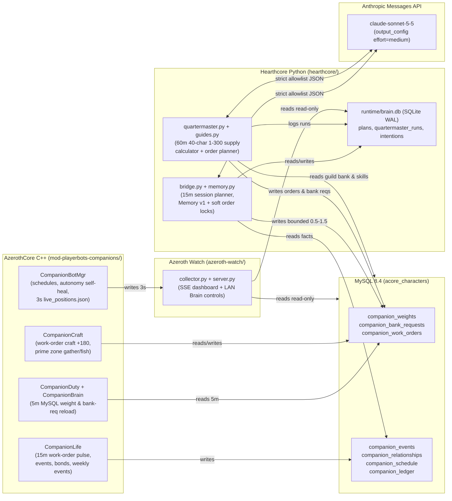

# Hearthguard Installed-System State & Architecture (M0 Audit)

This document is the authoritative inventory of the live Hearthguard private AzerothCore WotLK 3.3.5a stack as of **2026-11-24**. It satisfies the **M0 Installed-System Audit** prerequisite in [MEMORY_IMPLEMENTATION.md](./MEMORY_IMPLEMENTATION.md) so external contributors and AI assistants can reason about the exact live runtime without guessing.

---

## 1. Host & Container Topology

| Layer | Specification / Live Configuration |
|---|---|
| **Host** | Acer Aspire TC-780 (`i5-7400` 4C/4T, 7.2 GiB RAM, Ubuntu 26.04.1 LTS) |
| **CPU Pinning** | Cores `2-3`: Docker (`ac-worldserver`, `ac-database`, `ac-authserver`) Cores `0-1`: Host desktop, WoW client (DXVK), `azeroth-watch`, `hearthcore` timers |
| **Database** | Docker `ac-database` (`mysql:8.4`, `innodb_buffer_pool_size=256M`, `performance_schema=OFF`, `skip-log-bin`) |
| **Worldserver** | Docker `ac-worldserver` (`AzerothCore` + `mod-playerbots` local branch `companions` @ `862e9bb0`), `10–15 ms` mean tick diff, `0` bytes `Errors.log` |
| **Random Bots** | `50` Alliance-only (`MinRandomBots=50`, `MaxRandomBots=50`, `RandomBotMaps=0,1`, `IterationsPerTick=5`, `ReactDelay=150`) |
| **Companions** | `38` named Hearthguard Alliance companions (`core-wonky`, `core-logan`, `morning-crew`, `day-crew`, `evening-crew`, `night-crew`, `weekend-raiders`) |
| **Dashboard** | `azeroth-watch.service` (Python stdlib SSE/HTTP server on port `8787`, `~25 MiB` RAM, zero third-party deps) |
| **AI Brain Timers** | `hearthcore-brain.timer` (every `15m`, `claude-sonnet-5-5` `effort=medium`) `hearthcore-quartermaster.timer` (every `60m`, `claude-sonnet-5-5` `effort=medium`) |

---

## 2. End-to-End Architecture

---

## 3. Live Database Schemas

### Authoritative Game State (`acore_characters` in MySQL 8.4)

| Table | Purpose | Key Columns |
|---|---|---|
| `companion_schedule` | 38-companion roster & shift windows | `name, shift_group, start_hour, end_hour, days_mask, always_online, note` |
| `companion_profiles` | In-game lore / archetype metadata | `guid, name, archetype, culture, flaw, bio, updated_at` |
| `companion_weights` | Canonical persona & manual baseline weights (NEVER overwritten by temporary AI plans) | `guid, key, value, updated_at, source` |
| `companion_weight_overrides` | Expiring temporary AI session overrides with monotonic `revision` & `enabled` toggle (auto-expires back to baseline in C++) | `guid, key, value, plan_id, revision, source, enabled, created_at, expires_at` |
| `companion_proposals` | Typed, versioned AI goal proposals validated & reported by native C++ (`proposed`/`accepted`/`executing`/`completed`/`rejected`/`interrupted`/`expired`, plus `advisory_only`) | `id, plan_id, guid, character_name, goal_id, goal_type, target_id, advisory_only, snapshot_rev, status, outcome_reason, created_at, expires_at, started_at, ended_at, active_seconds, progress_delta` |
| `companion_bank_requests` | Guild vault target minimums farmed by `CompanionCraft::EvaluateGatherFarm` & `EvaluateFish` | `item_entry, requested_by, min_count, note, created_at` |
| `companion_work_orders` | Guild crafting commissions (`open`/`claimed`/`delivered`) | `id, requester_guid, requester_name, crafter_guid, crafter_name, item_entry, item_name, quantity, story, status, created_at, updated_at` |
| `companion_events` | Authoritative factual chronicle (milestones retained permanently; routine events bounded at 250/char) | `id, guid, event_type, summary, partner_guid, zone_id, created_at` |
| `companion_relationships` | Guild bonds & shared activity counters | `guid_a, guid_b, runs_together, wipes, help_given, loot_contests, affinity, last_event, updated_at` |
| `companion_ledger` | Trade/bank/craft/train audit log | `id, time, guid, action, item, count, tab, note` |
| `companion_rep_goals` | Long-term faction reputation targets | `guid, faction, target_rank, note` |
| `raid_gate` | Progression cap (`stage 0=Lv60/300`, `1=Lv70/375`, `2=Lv80/450`) | `stage, unlocked_at, killed_by` |

### Out-of-Loop Planner & Memory Store (`runtime/brain.db`, SQLite WAL — gitignored)

| Table | Purpose |
|---|---|
| `plans` | Audit of companion session plans (`plan_state='applied'|'shadow'`), token usage, latency, applied C++ weights, native `proposal_status`, and non-overlapping finalized goal-specific outcomes (`outcome_levels`, `outcome_xp`, `outcome_quests`, `outcome_skillups`, `outcome_orders`, `outcome_ledger_ops`). |
| `api_ledger` | Shared transactional API budget ledger (`BEGIN IMMEDIATE`) across individual planner, Quartermaster, manual, and shadow runs (`reserved`/`ok`/`rejected`/`uncertain`/`error`), monthly USD ceiling + daily call cap. |
| `quartermaster_runs` | Hourly Guild Quartermaster run logs (`is_shadow` isolated from live `quartermaster.json`). |
| `intentions` | Open/completed character intentions (`skill_tier` breakpoints `75/150/225/300` and claimed `work_order` IDs), reconciled against authoritative MySQL state each turn. |
| `event_journal` & `event_cursors` | Durable autobiographical event journal keyed by `companion_events.id` (`INSERT OR IGNORE`) with cursor checkpoints and honest gap detection. |

---

## 4. C++ Companion Weight Keys (`CompanionBrain.cpp`)

`hearthcore/bridge.py` (`weights_for_cpp`) writes ONLY these bounded `[0.5, 1.5]` numeric keys to `companion_weights`:

- `quest_work`, `quest_turnin`, `quest_hub`, `quest_grind`
- `craft`, `gather`, `fish`
- `train`, `bank`, `repair`, `sell`
- `travel`, `hearth`

`CompanionBrain::ReloadWeights()` picks up updates automatically within ~5 minutes with **zero worldserver restart**.

---

## 5. Key C++ Customizations (`mod-playerbots-companions/`, commit `862e9bb0`)

1. **Autonomy & Stability (`862e9bb0`, `ddd1c355`, `3f0a739e`):**
   - Self-heals drifted non-combat strategies (`-follow`, `-stay`, `+companion duty/quest/new rpg/grind`) while in `COMPANION_AUTONOMY`.
   - 15-minute motionless unstuck watchdog (`rpgInfo.ChangeToIdle()`, `botAI->Reset(true)`, aura cleanup).
   - Danger-death graveyard escape (`ReviveFromCorpseAction.cpp`) checks `CachedZoneAt()` for corpse, bot, and closest graveyard to prevent corpse-camping loops in high-level zones.
   - Hunter auto-ammo restock, bag cleaning, road routing, and 3-second `live_positions.json` snapshot.
2. **Guild Economy & Gathering (`751df22f`):**
   - `EvaluateGatherFarm` reads `companion_bank_requests` (mapping bars → ores) when `AiPlayerbot.Companion.GatherFarm.GuildRequests = 1`.
   - `NextGatherSpot` uses 2600 yd radius + live zone node density + verified Alliance prime farm-zone bonuses.
   - `EvaluateFish` targets Lesser/Regular/Greater Sagefish Schools (`180656`/`180663`/`180684`) within 1800 yd when guild vault requests Sagefish (`21071`/`21153`).
3. **Guild Life v2 (`e3b2eefa`, `123bdaca`):**
   - Autonomous work-order pulse (every 15m), `+180` crafter priority boost for open guild orders, neighbourhood presence bonus, weekly guild event calendar (Wed Craft / Fri Fishing / Sun Dungeon), and proximity guild bonds.

---

## 6. Hard Safety Invariants

- **Authoritative Server:** Game server and MySQL are always truth for level, XP, gear, items, quests, GUIDs, and actions.
- **Allowlist Only:** Claude may ONLY choose `primary_goal_id` / `secondary_goal_ids` from server-generated eligible candidates; `core.validate()` rejects any unknown ID or out-of-range weight (`[0.5, 1.5]`).
- **Zero LLM Chat:** No raw model output is ever sent to in-game chat.
- **Graceful Fallback:** Any API failure or daily cap hit falls back cleanly to deterministic scoring.
- **No Secrets in Git:** `.env`, `runtime/`, database dumps, and Blizzard MPQ extracted artwork (`.png`/`.jpg`) are strictly excluded from version control.
